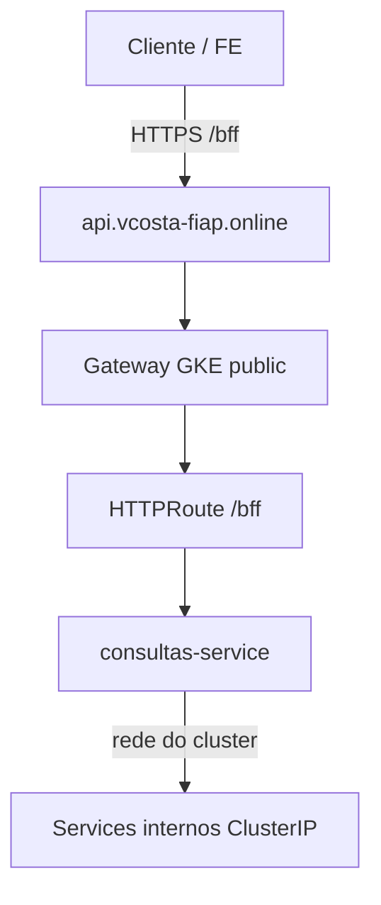

# infra-k8s

Terraform do **GKE Autopilot** e da borda HTTPS do FIAP X ([`fiap-x-vcosta`](https://github.com/fiap-x-vcosta)).

Canon de produto: [`docs`](https://github.com/fiap-x-vcosta/docs). Rede, zona DNS e SAs de runtime: [`infra-bootstrap`](https://github.com/fiap-x-vcosta/infra-bootstrap).

## Escopo

- Cluster GKE Autopilot `fiap-x-gke` em `us-central1` (ciclo de demo)
- Cloud NAT na subnet do bootstrap
- Namespace Kubernetes `fiap-x`
- Workload Identity (KSA → GSA de runtime) enquanto o cluster existir
- Gateway do GKE em `api.vcosta-fiap.online` + IP/cert managed
- **Única** rota pública: `/bff` → `consultas-service` (`bff`); demais serviços só internos
- **Sem** GCP API Gateway; **sem** records `www`/apex neste repo
- State remoto GCS (`fiap-x-vcosta-tfstate` / `infra-k8s`)

Root module: [`terraform/`](terraform/). Pin Terraform: **1.16.1** (alinhado a [`actions`](https://github.com/fiap-x-vcosta/actions)).

O manifesto do Gateway é [`terraform/gke-gateway.yaml.tpl`](terraform/gke-gateway.yaml.tpl) (aplicado pelo workflow; fora do state). `HTTPRoute` e Deployment de cada serviço ficam no repositório do serviço.

## Componentes



## Entrada pública

| Item | Valor |
|------|--------|
| Host | `api.vcosta-fiap.online` |
| Gateway | `public` (`gke-l7-global-external-managed`) |
| Namespace | `fiap-x` |
| Path público | `/bff` → `consultas-service` |
| Demais serviços | Internos (sem `HTTPRoute` público) |
| Front `www` / apex | Repo `web` (outro stack) |

### Contrato `HTTPRoute` (repo `consultas-service`)

```yaml
apiVersion: gateway.networking.k8s.io/v1
kind: HTTPRoute
metadata:
  name: bff
  namespace: fiap-x
spec:
  parentRefs:
    - name: public
      sectionName: https
  rules:
    - matches:
        - path:
            type: PathPrefix
            value: /bff
      backendRefs:
        - name: consultas
          port: 80
```

Sem `HTTPRoute` de serviço, o prefixo público responde 404 no Gateway. `/system` não atravessa a borda pública.

## State (GCS)

| Item | Valor |
|------|--------|
| Bucket | `fiap-x-vcosta-tfstate` |
| Prefix deste repo | `infra-k8s` |

## CI vs CD

| Tipo | Quando | Automático? |
|------|--------|-------------|
| **CI** `fmt` + `validate` (+ `plan` em PR) | PR / push | Sim |
| **`tf-apply` / `tf-destroy`** | Janela da demo | Só manual (`workflow_dispatch`) |

Merge em `main` **nunca** liga o cluster. Jobs extras (aplicar Gateway pós-apply; limpar Gateway/`HTTPRoute`/LBs pré-destroy) ficam nos callers `tf-apply` / `tf-destroy` deste repo, usando [`actions`](https://github.com/fiap-x-vcosta/actions).

Org vars: `GCP_WORKLOAD_IDENTITY_PROVIDER`, `GCP_SERVICE_ACCOUNT_EMAIL`, `GCP_PROJECT_ID`, `GCP_REGION`, `GCP_GKE_CLUSTER_NAME` (`fiap-x-gke`).

## Comandos locais

```bash
cd terraform
terraform fmt -check
terraform init -backend=false
terraform validate
```

Plan/apply reais: ADC ou workflow manual; backend GCS.

## Custo na janela

Autopilot + **um** LB global (Gateway do GKE) + Cloud NAT + IP/cert. Sem segundo LB de API Gateway. Sempre `tf-destroy` / `demo-down` ao fim da janela.

## Ordem na demo

1. `infra-bootstrap` já aplicado (zona DNS + NS no registrador)
2. Este repo → **tf-apply** (cluster + `api.` + cert + Gateway), em paralelo com [`infra-events`](https://github.com/fiap-x-vcosta/infra-events)
3. Esperar certificado de `api.` **Active**
4. `tf-apply` / deploy dos serviços (`HTTPRoute` `/bff` no `consultas-service`)
5. Destroy inverso: serviços → este repo → `infra-events`

## Decisões (ADRs)

Ver [`docs/README.md`](docs/README.md).

## Agentes

Ver [AGENTS.md](AGENTS.md).
